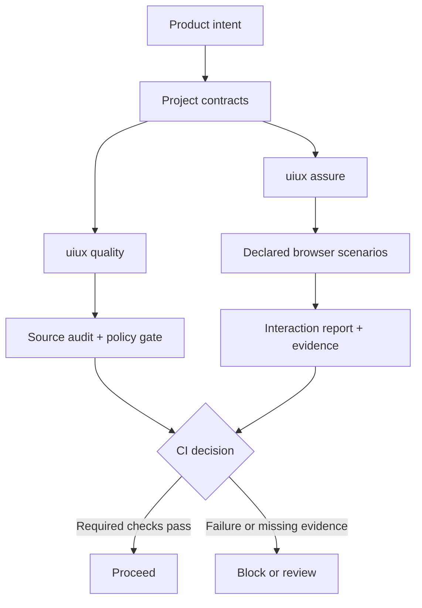

<div align="center">

# Modern UI/UX Decision Engine

### Stop shipping interfaces that only look finished.

An evidence-driven UI/UX engineering toolkit for AI coding agents.

Turn product intent into project contracts, inspect source code, test declared
user journeys in a browser, and enforce quality gates in CI.

[Quick start](#quick-start) · [How it works](#how-it-works) · [CLI reference](#cli-reference) · [Limits](#what-results-prove)

</div>

## The problem

AI can produce polished screens in minutes. That does not mean the interface
supports the user's task, handles failure correctly, or prevents a harmful
action.

A screenshot cannot tell you whether a form recovers from a network error. A
static lint check cannot tell you whether a loading state appeared. A passing
browser assertion cannot prove that a backend transaction was committed.

This engine keeps those claims separate and makes the checks executable.

| Without an explicit quality contract | With this engine |
|---|---|
| “Make it modern and user-friendly.” | Declare tasks, states, constraints, and completion conditions. |
| Subjective review after implementation | Repeatable source checks and task-scoped rule selection. |
| “The button seems to work.” | Browser assertions against specified interaction scenarios. |
| A screenshot presented as proof | Evidence-limited reports with explicit unverified outcomes. |
| Agent instructions that can be ignored | Project-local contracts and CI exit codes. |

## Four execution boundaries

Installation, activation, enforcement, and runtime assurance are different
system boundaries:

| Boundary | What it does | What proves it |
|---|---|---|
| Installation | Makes the CLI/skill available | Package installation and version check |
| Activation | Tells an agent to load the project policy | Project-local `AGENTS.md` or equivalent |
| Enforcement | Blocks incomplete or disallowed changes | `uiux quality` and CI exit codes |
| Runtime assurance | Executes declared scenarios and records evidence | `uiux assure --execute --browser chromium` |

Installing this package does not automatically activate every agent, change
global configuration, enforce a project policy, or verify runtime behavior.

## How it works



## Quick start

Requirements: Node.js 20+ and npm.

```bash
npm install
npm test
npm link
```

Initialize a project without overwriting existing files:

```bash
uiux init . --agent --ci
```

The initializer detects the framework and package manager, creates missing
contracts with `UNSPECIFIED` placeholders, and never invents business goals.
`--agent` creates a project-local `AGENTS.md`; `--ci` creates a GitHub Actions
quality job. Neither option edits global agent configuration.

Replace the placeholders, then run the static/project gate:

```bash
uiux audit . --format markdown
uiux quality . --brief ai-ux-brief.json --task form,feedback,recovery --format markdown
```

## Project contracts

`uiux init` creates only missing files:

```text
my-app/
├── DESIGN.md          # Human-readable goals and information priorities
├── uiux.config.json   # Rule scope, versions, blocking policy, evidence path
├── interaction.json   # Browser actions, assertions, and network expectations
├── tasks.json         # User goals and completion criteria
├── ai-ux-brief.json   # AI authority, uncertainty, provenance, correction
├── state-policy.json  # Async states, transitions, and evidence requirements
└── AGENTS.md          # Optional project-local agent instructions
```

Human intent lives in Markdown. Executable expectations live in JSON. When
they conflict, review the discrepancy; do not let an agent silently guess.

Machine-readable schemas are provided for the AI brief, interaction contract,
task manifest, state policy, and evolution manifest in [`schemas/`](schemas/).
The complete contract and release definition of done are in
[`QUALITY_SPEC.md`](QUALITY_SPEC.md).

## Browser assurance

Browser execution is optional and requires Playwright, Chromium, and a running
test application matching the target URL in the interaction contract.

```bash
npm install --save-dev playwright axe-core
npx playwright install chromium

uiux doctor
uiux assure \
  --tasks tasks.json \
  --contract interaction.json \
  --execute \
  --browser chromium \
  --out assurance.json
```

For the repository's self-contained browser fixtures:

```bash
UIUX_BROWSER_E2E=1 npm run test:browser
npm run test:ci-framework
npm run verify:ci-bundle
```

The presence of these commands does not prove that Chromium ran successfully
in the current environment. Check the actual report and CI receipt.

## What it checks

| Capability | Mechanism | Important boundary |
|---|---|---|
| Source audit | HTML tokenization, TypeScript AST for JSX/TSX and JS/TS call sites, heuristic CSS checks | Static findings are not rendered-DOM proof. |
| Rule contracts | Versioned source-rule identifiers, task tags, trigger/counterexample/boundary fixtures | Selection is not execution. |
| Project quality gate | Declared intent, contracts, task scope, static blockers, verification gaps | Does not execute browser scenarios. |
| Interaction assurance | Playwright steps, DOM assertions, scoped network stubs, request counts | Verifies only declared scenarios and assertions. |
| State observation | Explicit `data-ux-state` attributes and scoped network events | Does not observe invisible framework state. |
| Transport classification | HTTP responses, timeouts, cancellation signals, network failures | Network outcomes do not prove backend persistence. |
| Evidence integrity | SHA-256 manifests, report consistency, bounded evidence correlation | Integrity hashes are not provenance authentication. |
| Evaluation | Frozen datasets, review, adjudication, and baseline comparison | No representative real-world accuracy claim. |
| AI UX policy | Authority, uncertainty, provenance, correction, and recovery requirements | A declaration does not prove compliant behavior. |
| Policy evolution | Evidence-linked episodes and pinned-baseline comparison | Candidates are never self-deployed. |

Outputs include Markdown, JSON, and SARIF 2.1.0 where supported by the
command.

## Controlled policy evolution

Evaluate a candidate interaction policy against a measured baseline:

```bash
uiux evolve examples/evolution-manifest.json --format markdown
```

The manifest records state/action/reward/outcome tuples and may link episodes
to reviewed evidence. A candidate is accepted only when it exceeds the
declared improvement threshold and has no declared blocked, unauthorized, or
duplicate-side-effect episodes.

This command evaluates and reports only. It never invents rewards, rewrites
rules, deploys code, or treats one anecdotal success as learning evidence.
`CANDIDATE_ACCEPTED` means the offline gate passed; it is not deployment
authorization.

## Example: a save form that fails safely

If a user submits a form and the server returns HTTP 503, a useful contract
should assert more than “an error message exists”:

1. The user can initiate a save with valid input.
2. A pending state is observable while the request is in flight.
3. The failure is communicated without falsely reporting success.
4. The user can retry under the declared recovery policy.
5. The recorded request count matches the explicit expectation.

The included React and Vue examples use mocked responses. A mocked API makes a
failure scenario reproducible; it is not evidence of production backend
correctness.

## CLI reference

| Command | Purpose |
|---|---|
| `uiux init [path] [--agent] [--ci]` | Detect the project and create missing contract templates. |
| `uiux audit [path]` | Static source audit; supports Markdown, JSON, and SARIF. |
| `uiux quality [path]` | Project decision and enforcement gate. |
| `uiux assure --tasks FILE --contract FILE` | Evaluate task assurance, optionally executing Chromium. |
| `uiux runtime URL_OR_HTML` | Optional Playwright/axe browser audit. |
| `uiux plan --brief FILE` | Validate a declared task brief and propose states. |
| `uiux rules` | List available rules. |
| `uiux rule-contracts` | Inspect selected executable rule contracts. |
| `uiux doctor` | Check local browser-test prerequisites. |
| `uiux observe-states` | Observe declared DOM state transitions and network events. |
| `uiux audit-causality` | Conservatively audit observed event relationships. |
| `uiux network-outcomes` | Classify recorded transport outcomes. |
| `uiux coverage` | Report declared and observed interaction coverage. |
| `uiux benchmark` / `uiux evaluate` | Run scoped detector evaluation. |
| `uiux evolve MANIFEST.json` | Evaluate a candidate policy against a pinned baseline. |

For additional flags and historical behavior, see
[`QUALITY_SPEC.md`](QUALITY_SPEC.md), [`EVALUATION_PROTOCOL.md`](EVALUATION_PROTOCOL.md),
and the versioned release notes.

## CI exit codes

Quality/enforcement commands use these conventions:

| Code | Meaning |
|---:|---|
| `0` | Required checks passed or the project is ready for verification. |
| `1` | Blocking finding or failed required gate. |
| `2` | Command or configuration error. |
| `3` | Required evidence is missing or inconclusive. |
| `4` | Execution infrastructure failure. |

Specialized commands may use command-specific nonzero classifications. An
unverified result is never silently counted as passed. Mandatory checks should
fail closed.

## What results prove

A passing result means the declared checks passed in the stated scope. It does
not mean the product is universally usable.

- Static audit identifies supported source patterns; it does not certify accessibility or task success.
- Browser assurance verifies explicitly asserted interactions in the selected browser and environment; it does not prove production reliability or transaction persistence.
- Network stubs make failure scenarios reproducible; they do not establish live-service behavior.
- Evidence hashes detect modification relative to a manifest; they do not authenticate who ran the test.
- Evaluation fixtures measure performance on the included dataset; they do not establish population-wide precision or recall.
- An installed skill does not prove agent activation.
- Agent activation does not prove project enforcement.
- Project enforcement does not prove runtime behavior.

Browser screenshots and traces may contain sensitive data. Evidence capture is
opt-in; use synthetic accounts and restrict access to collected artifacts.

## Project status and limitations

Implemented capabilities include source AST checks, project initialization,
contract-based quality gates, Playwright interaction runners, React/Vue
fixtures, state observation, transport classification, report-integrity
validation, evidence tooling, and controlled policy-evolution evaluation.

Still requiring independent verification are successful Chromium execution for
the current revision, representative real-project detector accuracy,
production backend correctness, and full accessibility conformance. The engine
makes none of these certification claims.

Known limitations and the release definition of done are maintained in
[`QUALITY_SPEC.md`](QUALITY_SPEC.md). Browser-related changes should include a
reproducible Chromium test and state whether it actually ran.

## Contributing

Contributions are welcome when they improve observable behavior, rule precision,
or reproducibility. For a new rule, include applicability, a counterexample,
an evidence boundary, tests, and a rationale for its severity. Avoid adding
purely subjective visual preferences as unconditional blockers.

```bash
npm test
npm run test:quality
npm run test:evolution
```

## License

Original project code is licensed under MIT. Third-party dependencies retain
their respective licenses; see [LICENSE](LICENSE) and
[`THIRD_PARTY_NOTICES.md`](THIRD_PARTY_NOTICES.md).

<div align="center">

Better UI is not just what users see. It is what they can reliably do.

</div>
